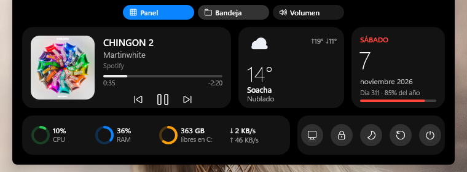
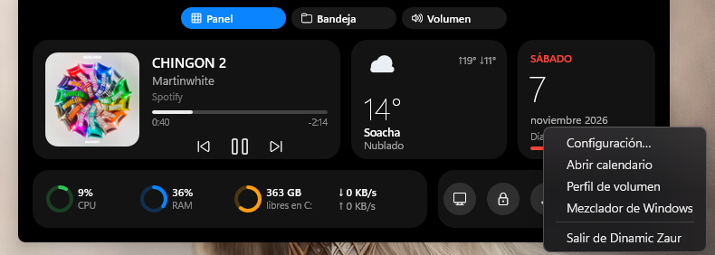
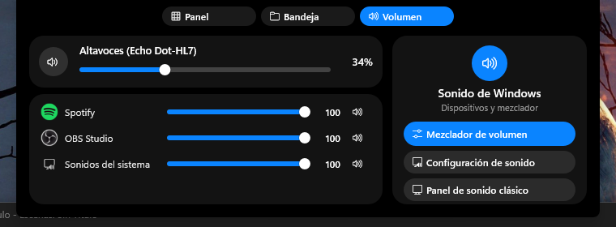
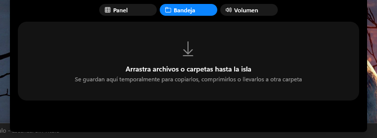
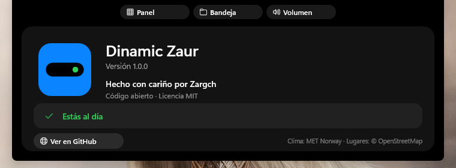
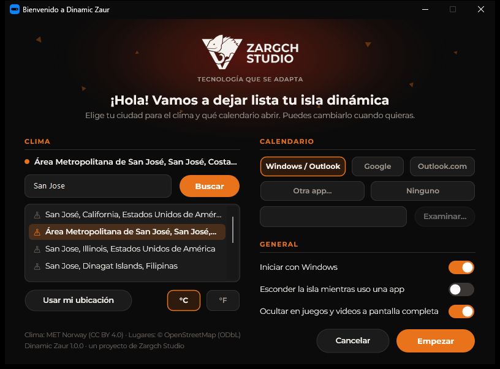

# Dinamic Zaur

A dynamic island for Windows: a small black pill at the top of the screen that shows your music, volume changes, Caps/Num Lock and the weather, and expands into a panel when you click it.

*Una isla dinámica para Windows. La interfaz está en español o inglés según el idioma de Windows.*



## Download

Get the latest version from [Releases](https://github.com/Zargch/dinamic-zaur/releases/latest):

- `DinamicZaur-x64.exe` for 64-bit Windows (most PCs)
- `DinamicZaur-x86.exe` for 32-bit Windows
- `DinamicZaur-1.0.0-portable.zip` with both versions

The app isn't code-signed yet, so Windows SmartScreen may warn you the first time. Click **More info → Run anyway**.

## Screenshots

| | |
|---|---|
|  |  |
| Compact island while music plays | Track change |
|  |  |
| Volume indicator | Right-click menu |
|  |  |
| Volume profile with the per-app mixer | Shelf for dropped files |
|  |  |
| Hidden *About* screen with update check | First-run setup |

## Features

- **Music**: title, artist and cover art from any app that uses the Windows media controls (Spotify, browsers, YouTube Music, etc.). Play, pause, next and previous. Click the track to jump to the app that's playing.
- **Volume**: on-screen indicator when the volume changes, plus a **volume profile** tab with a per-app mixer and shortcuts to the Windows sound settings.
- **Weather** for any city in the world, in °C or °F.
- **Calendar**: today's date and year progress. Clicking it opens the calendar you choose: Windows Calendar/Outlook, Google Calendar, Outlook.com, any other app or web page, or none.
- **Shelf**: drop files on the island to keep them handy, then copy, zip, move or drag them out.
- **System**: CPU, RAM, free disk space and network speed, plus lock, sleep, restart and shut-down buttons.
- Hides itself over full-screen games and videos. Optionally hides while you use an app; move the mouse to the top edge to bring it back.

## Requirements

- Windows 10 version 1809 or later, or Windows 11
- 64-bit (`DinamicZaur-x64.exe`) or 32-bit (`DinamicZaur-x86.exe`)

No installation is required. Run the `.exe`. On the first run, a welcome window asks for your city and calendar. Settings are stored in `%APPDATA%\DinamicZaur\config.ini`.

To change settings later, use the tray icon or right-click the island. Press **Ctrl+Alt+Shift+Q** to quit.

## Building

You need Visual Studio 2019 or later (or the Build Tools) with the C++ desktop workload and a Windows 10 SDK.

```bat
build.bat        :: builds x64 and x86 into dist\
build.bat x64    :: 64-bit only
build.bat x86    :: 32-bit only
```

The optional installer is built with [Inno Setup 6](https://jrsoftware.org/isinfo.php) from `installer\DinamicZaur.iss`.

## Data sources and attribution

- Weather data: **[MET Norway](https://api.met.no/)** Locationforecast API, licensed under [CC BY 4.0](https://creativecommons.org/licenses/by/4.0/).
- Place search and names: © **[OpenStreetMap](https://www.openstreetmap.org/copyright)** contributors, via Nominatim, licensed under ODbL. Searches run only when you press *Search* (no autocomplete), in line with the [Nominatim usage policy](https://operations.osmfoundation.org/policies/nominatim/).
- Update check: the GitHub Releases API. It runs only when you open the hidden *About* screen.

No accounts, API keys or telemetry are used.

## Easter egg

There's a hidden *About* screen. Open the panel and click the system card (CPU / RAM) five times quickly. It shows who made the app and whether a newer version is available.

## License

[MIT](LICENSE) © 2026 Zargch

The Zargch Studio name and logo belong to Zargch Studio and aren't covered by the MIT license.
